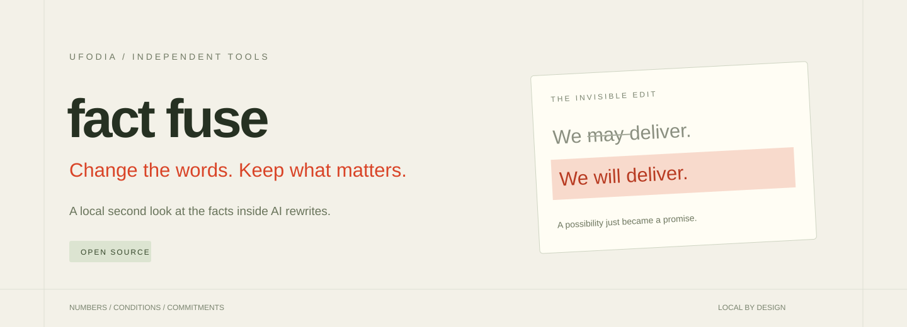
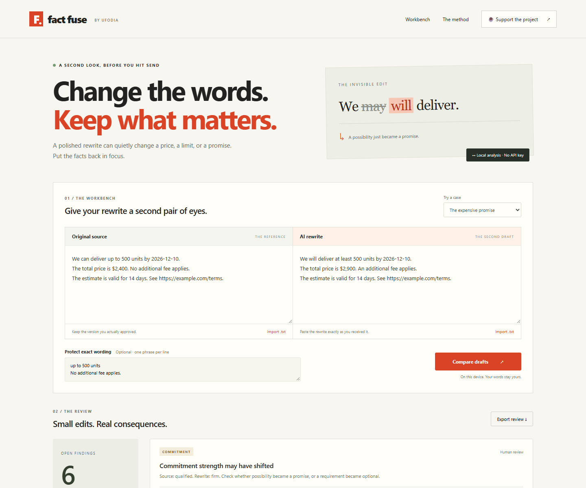

<p align="center"></p>

<p align="center"><strong>A careful second look at AI rewrites.</strong><br>Find changed quantities, missing conditions, and stronger promises before you hit send.</p>

<p align="center"><a href="LICENSE"></a>   <a href="https://buymeacoffee.com/ufodia"></a></p>


**[Open the live app ↗](https://fact-fuse.vercel.app/)** · [Deployment guide](docs/DEPLOYMENT.md)

## The problem hiding inside a better sentence

You ask an assistant to make a proposal sound more professional. It changes **“we may deliver up to 500 units”** to **“we will deliver at least 500 units.”** The grammar improved. The agreement changed.

Fact Fuse gives you a local workbench for comparing the approved source with a rewrite. It separates observable changes from language heuristics, keeps the evidence beside every finding, and lets you mark findings reviewed before exporting a portable report.



## Start here

You need **Node.js 24.18 or later** and npm. No account, API key, database, or model download is required.

```bash
git clone https://github.com/ufodia/fact-fuse.git
cd fact-fuse
npm ci
npm run dev
```

Open the local URL printed by Vite. The **expensive promise** example is ready to inspect. Choose **Equivalent number formats** for a clean comparison, or paste your own text.

## What you can do

| Check | What it observes | Interpretation |
| --- | --- | --- |
| Quantities | Normalized numbers, supported currencies/units, occurrence counts | A token-level difference to inspect; business days and calendar days are distinct units |
| Dates | ISO dates and slash-form dates | Exact date-token comparison; ambiguous dates remain ambiguous |
| Links | HTTP(S) URLs and repeated occurrences | A link was added, removed, or changed |
| Protected wording | Your exact, case-sensitive phrases | The phrase or its occurrence count changed |
| Negation | Explicit negative-word counts | Human review; equivalent wording can be flagged |
| Commitment | Firm vs qualified language | Human review; a possibility may have become a promise |
| Results caveats | A small set of “results may vary” or “outcomes may vary” phrases | Human review; other disclaimers and paraphrases can be missed |
| Thresholds | Minimum vs maximum expressions | Human review; a limit may have changed |
| Conditions | A fixed list of explicit English markers | A missing source marker gets an approximate source-span highlight; paraphrases may be missed or flagged |
| Scope and timing | Selected explicit markers and relative-deadline trigger phrases | Human review; changed event wording can be equivalent or missed |
| Coverage | Sentences without a lexical match | Human review; omissions, additions, and heavy paraphrases |

Number formatting such as `1.234,50` and `1,234.50` is normalized. Common English written cardinal numbers, including `a dozen`, are compared with digit forms. Repeated quantities are counted. Text imports support `.txt` and `.md`; report exports are JSON. Input remains in memory until you leave or reload the page.

**A clear report is not a guarantee of equivalent meaning.** This is a rule-based review aid, not a factual-truth detector. Read the [method and limitations](docs/limitations.md) before using it for important work.

## A review in four steps

1. Paste the approved source and the AI rewrite, or import text files.
2. Add any exact phrases you want to protect, one per line.
3. Compare the drafts and inspect the quoted evidence. Mark findings reviewed when you have made your decision.
4. Export the review. Editing either draft invalidates the previous review, so an old report cannot silently describe new text.

Read the [user guide](docs/user-guide.md) for a complete walkthrough.

## Use it in a script

The CLI uses the same core engine as the browser:

```bash
npm run analyze -- examples/source.txt examples/rewrite.txt review.json examples/locked.txt
```

The first two arguments are input paths. The optional third argument is the output report; omit it to print JSON. The optional fourth is a newline-separated lock file. Invalid input exits with code `1`; missing arguments exit with `2`. Findings are review data and do not change the exit code.

For programmatic use:

```ts
import { analyze } from './src/core.ts';

const report = analyze(
  'We may deliver up to 500 units.',
  'We will deliver at least 500 units.',
  ['up to 500 units'],
);
console.log(report.findings.map(finding => finding.kind));
```

The source is intended for local development; an npm package is not published. See the [report format](docs/formats.md) and [architecture](docs/architecture.md).

## Development

```bash
npm run typecheck
npm test
npm run build
npm run preview
```

`npm run check` runs type checking, unit tests, and a production build. CI executes those checks on pushes and pull requests. It does not deploy the app.

## Privacy and security

Analysis does not send drafts to a server, load remote fonts, or use analytics. The README badges and support links are external resources; opening those links contacts their providers. Vite is a local development server and binds to loopback by default. Do not expose it as a public processing service.

See [SECURITY.md](SECURITY.md) for responsible reporting, and [CONTRIBUTING.md](CONTRIBUTING.md) for development and review expectations.

## Support independent tools

If Fact Fuse saved a price, a promise, or a painful round of proofreading, you can help keep it maintained.

<a href="https://buymeacoffee.com/ufodia"></a>

You can also [sponsor ufodia on GitHub](https://github.com/sponsors/ufodia).

Reproducible bug reports and anonymized before/after examples are valuable contributions too. Never submit client text or confidential material in a public issue.

## License

[MIT](LICENSE) · Copyright © 2026 **Ufodia**. Dependency licenses remain with their respective authors.

## Browser checks

The real workbench flow is covered by [Playwright browser tests](docs/BROWSER_TESTS.md), including local exports and mobile layout. Run `npm run test:browser` after installing Chromium.
