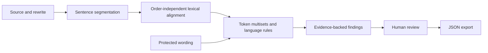

# Architecture

`src/core.ts` is a pure analysis engine shared by `src/main.ts` and `src/cli.ts`. It returns data and does not access the DOM, filesystem, network, or clock. Sentence alignment uses maximum-weight one-to-one lexical matching and permits reordered sentences; low-overlap sentences remain unmatched. The 400-sentence limit bounds alignment memory and work.

Number, date, and URL checks compare multisets within aligned pairs. Repeated values cannot disappear unnoticed just because one copy remains. Simple language rules inspect explicit negative words, qualified/firm commitments, and minimum/maximum expressions. The engine never asks a second model to act as a truth oracle.

The browser owns the editable drafts and review-ID set. All user-derived content is inserted using `textContent`. Changing a draft clears the report and review state. Data is not persisted. Vite builds static assets into `dist`; there is no application server or database.

The CLI uses Node's filesystem only at the caller-specified paths. Unit tests cover behavioral examples rather than DOM snapshots. No release, deployment, or publishing job is configured in CI.
